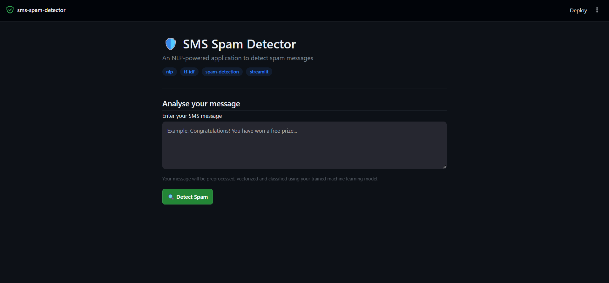

# SMS Spam Detection

A machine learning project that classifies SMS messages as **spam** or
**not spam** using Natural Language Processing (NLP) and a trained
Multinomial Naive Bayes model. The project includes a Streamlit web
interface where users can enter a message and view the prediction.

## Features

-   Enter an SMS message through a simple Streamlit interface.
-   Preprocess text by lowercasing, tokenizing, removing stopwords and
    punctuation/non-alphanumeric tokens, and stemming words.
-   Convert processed text into numerical features using a saved TF-IDF
    vectorizer.
-   Predict whether the message is spam or not spam with a trained
    machine learning model.
-   Inspect the preprocessed text and TF-IDF feature shape in the
    interface.

## Tech Stack

-   **Python**
-   **Pandas and NumPy** for data handling
-   **NLTK** for text preprocessing
-   **Scikit-learn** for TF-IDF vectorization and machine learning
-   **Multinomial Naive Bayes** for classification
-   **Streamlit** for the web interface
-   **Pickle** for saving and loading the trained model and vectorizer

## Project Structure

Make sure the saved model files are in the same project folder as
`app.py`.

``` text
SMS-Spam-Detection/
├── app.py
├── model.pkl
├── vectorizer.pkl
├── spam.csv
├── NOTEBOOK.ipynb
└── venv/
```

-   `app.py` --- Streamlit application.
-   `model.pkl` --- trained classifier saved from the notebook.
-   `vectorizer.pkl` --- fitted TF-IDF vectorizer.
-   `spam.csv` --- SMS dataset used for training and analysis.
-   `NOTEBOOK.ipynb` --- notebook containing the data preparation and
    model-training workflow.
-   `venv/` --- local Python virtual environment (not required in the
    repository).

## Setup and Installation

### 1. Clone or download the project

If the project is on GitHub, clone it and move into the project
directory:

``` bash
git clone <YOUR_REPOSITORY_URL>
cd SMS-Spam-Detection
```

Replace `<YOUR_REPOSITORY_URL>` with your repository URL.

### 2. Create and activate a virtual environment (recommended)

**Windows PowerShell:**

``` powershell
python -m venv venv
.\venv\Scripts\Activate.ps1
```

If PowerShell blocks activation, you can run the commands below using
the Python executable inside `venv`, or use Command Prompt activation
instead:

``` bat
venv\Scripts\activate.bat
```

### 3. Install dependencies

``` bash
python -m pip install --upgrade pip
python -m pip install streamlit pandas numpy scikit-learn nltk
```

## Model Files

The Streamlit app expects these two files to exist in the project
directory:

-   `model.pkl`
-   `vectorizer.pkl`

Generate them by running the notebook's training cells and its final
cell that saves the fitted model and vectorizer. Ensure the model and
vectorizer are saved from the same training workflow and are compatible
with the preprocessing used by `app.py`.

If these files are missing, the app will not be able to load the trained
model.

## Run the Application

From the project directory, run:

``` bash
python -m streamlit run app.py
```

Streamlit should open the application in your browser. If it does not,
visit:

``` text
http://localhost:8501
```

## How It Works

1.  **Input:** The user enters an SMS message.
2.  **Preprocessing:** The text is lowercased, tokenized, filtered to
    remove stopwords and non-alphanumeric tokens, and stemmed using
    Porter Stemmer.
3.  **Vectorization:** The fitted TF-IDF vectorizer transforms the
    processed message into numerical features.
4.  **Prediction:** The trained Multinomial Naive Bayes classifier
    predicts the class.
5.  **Output:** The app displays **SPAM DETECTED** or **NOT SPAM**.

The preprocessing applied in the app should match the preprocessing used
when preparing the training data.

## Example Messages

**Possible spam example:**

``` text
Congratulations! You have won a free prize. Claim your reward now!
```

**Possible legitimate example:**

``` text
Hey, are we still meeting tomorrow?
```

These are examples for testing, not guaranteed predictions. Model
predictions depend on the training data and learned patterns.

## Notes and Limitations

-   This is a machine learning classifier, so it can make incorrect
    predictions.
-   A message labelled "not spam" is not guaranteed to be safe. Avoid
    opening suspicious links or sharing personal information based only
    on this prediction.
-   NLTK may need to download the `punkt_tab` tokenizer data and English
    stopwords the first time the app runs. An internet connection may be
    needed if these resources are not already installed.
-   Do not commit your virtual environment (`venv/`) to GitHub.
-   Only load pickle files you trust, because pickle files can execute
    code when loaded.

## Future Improvements

-   Display prediction confidence where supported by the trained model.
-   Add evaluation metrics such as precision, recall, F1-score and a
    confusion matrix.
-   Improve the interface with example-message buttons and a message
    history.
-   Deploy the Streamlit app online.

## Author

Created as an NLP and machine learning project to explore SMS text
preprocessing, TF-IDF feature extraction, text classification and a
Streamlit application.
